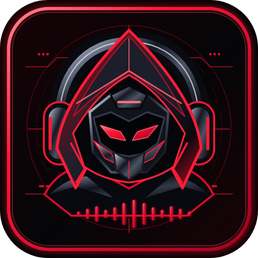
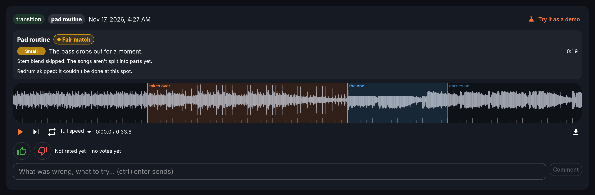
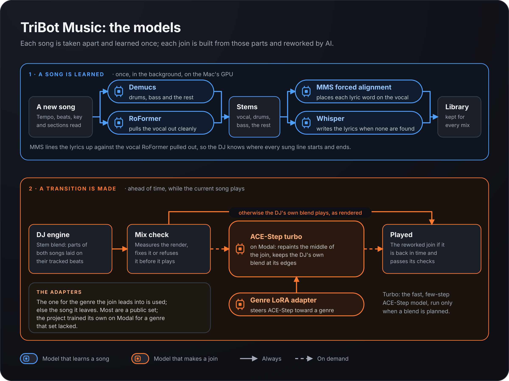
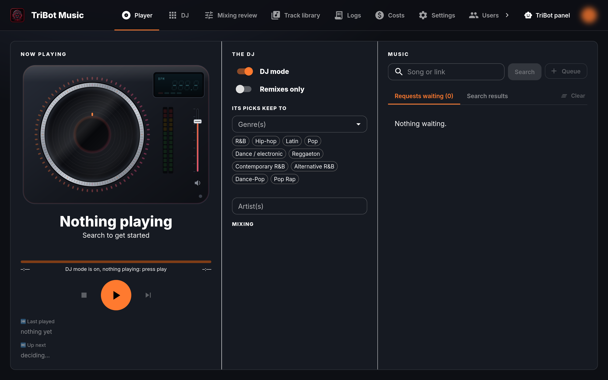
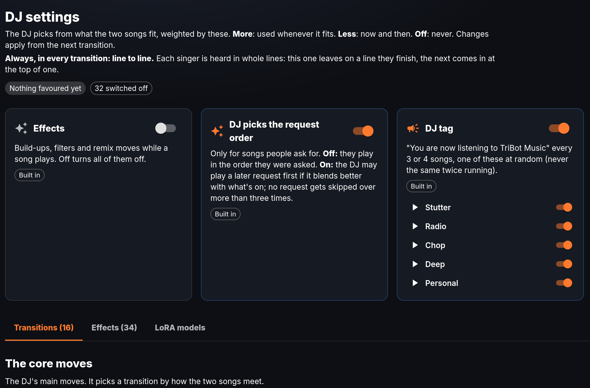
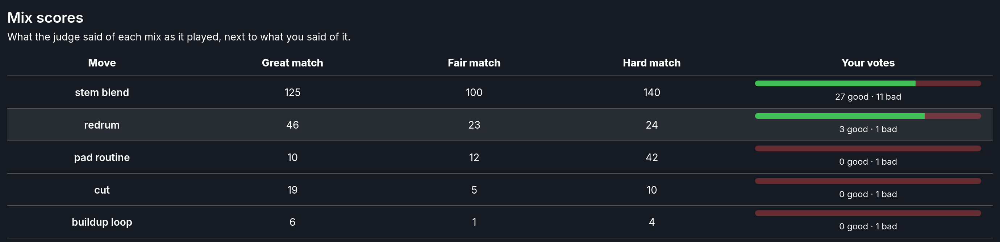
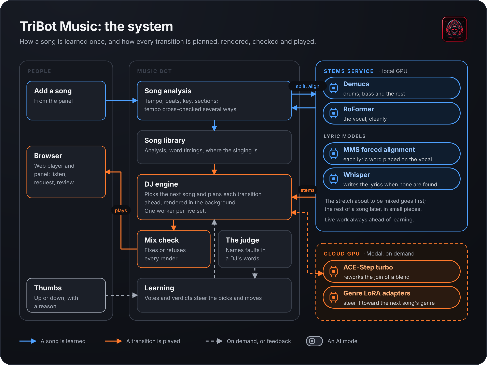
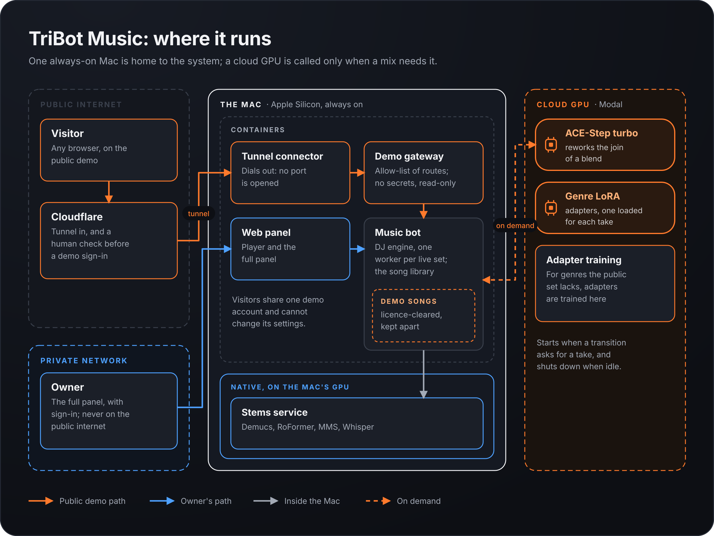

  

<h1 align="center">TriBot Music</h1>

An AI DJ that mixes songs like a club DJ, from the stems up.

  <strong><a href="https://tribot-music.osanchezdev.com">Live demo</a></strong> ·
  <a href="docs/how-it-chooses.md">How it chooses</a> ·
  <a href="docs/how-it-mixes.md">How it mixes</a> ·
  <a href="docs/architecture.md">Architecture</a> ·
  <a href="docs/challenges.md">Challenges</a>

  

## Why it's different

Most mixing is a crossfade: one finished track fades out while another fades in. TriBot Music takes both songs apart and rebuilds the join.

It can slip its own drum performance under the last singer's line, chop the outgoing record on pads like an MPC player, or build toward a drop and land on it. The singer finishes the line before the next one begins.

That works because every song is understood down to the beat, the bar, each singer's lines and every word. Every transition shows the reasons behind it, and the listener's thumbs teach it what to do next.

We have not found another project that does all of this together.

## What it is

TriBot Music plays in a web player in any browser. Each song is taken apart once into vocals, drums, bass and the rest, with its tempo, beats, key, sections and word-by-word lyric timing kept alongside. The DJ then picks the next song, plans the transition, renders it ahead of time in the background, and plays it. How it decides: [How it chooses](docs/how-it-chooses.md).

## The models behind it

**Taking a song apart**
- **Demucs:** splits a song into drums, bass and the rest.
- **A RoFormer model:** pulls the vocal out more cleanly than Demucs alone.

**Understanding the words**
- **MMS forced alignment:** a speech model that places each lyric word at the moment it is sung.
- **Whisper:** writes down the lyrics from the vocal when none can be found.

**Reworking the join**
- **ACE-Step (turbo) on Modal:** an audio generation model, run on demand on Modal's cloud GPUs, that reworks the join of a blend while the DJ's own blend is kept at its edges.
- **Genre LoRA adapters:** small add-ons that steer ACE-Step toward the sound of the genre the join leads into. Some are ready-made public ones; for a genre the public set lacked, the project trained its own on Modal, from songs of that genre.

**Building it**
- **Claude Code:** plans, writes and tests the project as an orchestrator with worker agents, under the owner's direction.

## Features

- A web player and panel that work in any browser.
- The next song is picked for key, tempo, genre, energy and where the night is. Requests go first.
- A night arc: warm-up, build, peak, breather, then around again.
- Many transition moves: stem blend, redrum, pad routine, echo out, scratch and more. See [how it mixes](docs/how-it-mixes.md).
- Risers, crashes and pumps, with sounds chosen per transition.
- Generated "AI mixes" on a cloud GPU when asked.
- A mixing review of what the DJ did and why.

## Screenshots

*The player, between sets: the deck, DJ mode, the genres its picks keep to, and requests.*

*Settings: the DJ's moves and extras, each with its own switch.*

*How the mixes score: the judge's verdict per move beside the listener's votes.*

## Architecture

A web player and panel talk to the music bot and its DJ engine, which draws on the song library, a stems service on a local GPU, and a cloud GPU on demand. More in [docs/architecture.md](docs/architecture.md).

### Where it runs

One always-on Apple Silicon Mac is the system's home: the music bot, the web panel and the demo gateway run in containers, and the stems service runs natively beside them to use the Mac's GPU. Modal supplies cloud GPUs on demand.

The public demo is the same player served as a limited panel, with only the demo's features, reached through Cloudflare. The full panel is reached only on a private network. Both are doors into the same music bot and the same DJ engine.

## Challenges

Wrong tempos, colliding singers, one synth everywhere, and one GPU shared with a live set. See [docs/challenges.md](docs/challenges.md).

## How it keeps improving

Listener thumbs, an automatic mix check, an offline judge, trials on real songs, and a written decision log, in a project built by AI coding agents under the owner's ear. See [docs/how-it-improves.md](docs/how-it-improves.md).

## About this repository

The source code of TriBot Music is private. This repository is the project's public write-up: text and images only. See [NOTICE.md](NOTICE.md).

---

Built by Omar Sanchez. Live demo: https://tribot-music.osanchezdev.com
