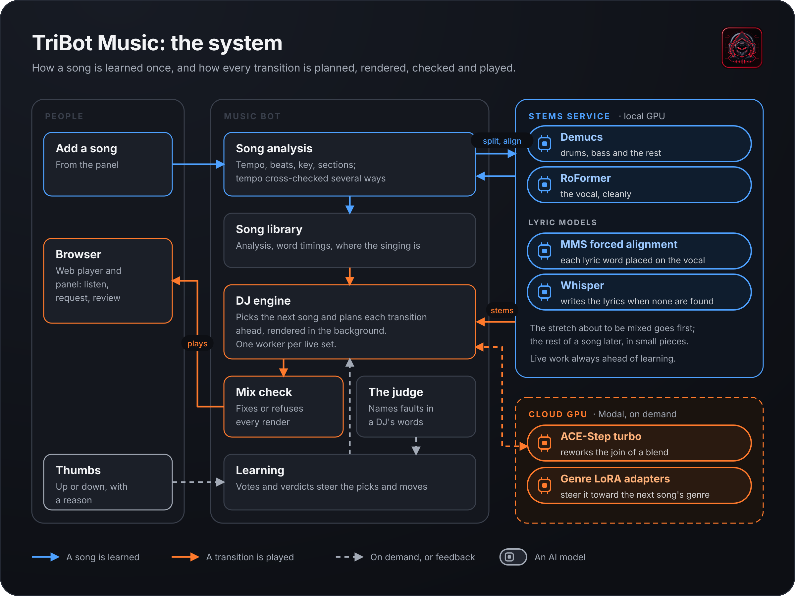
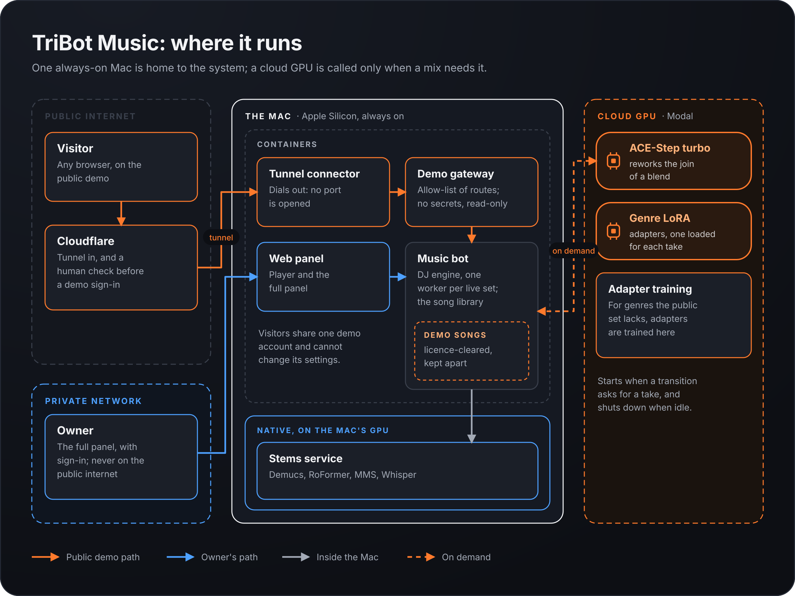
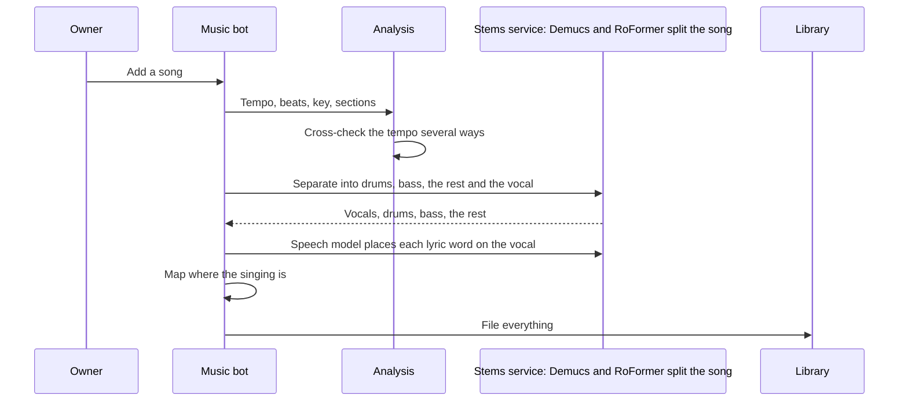
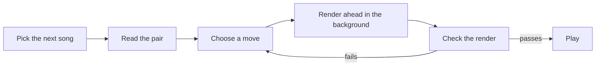
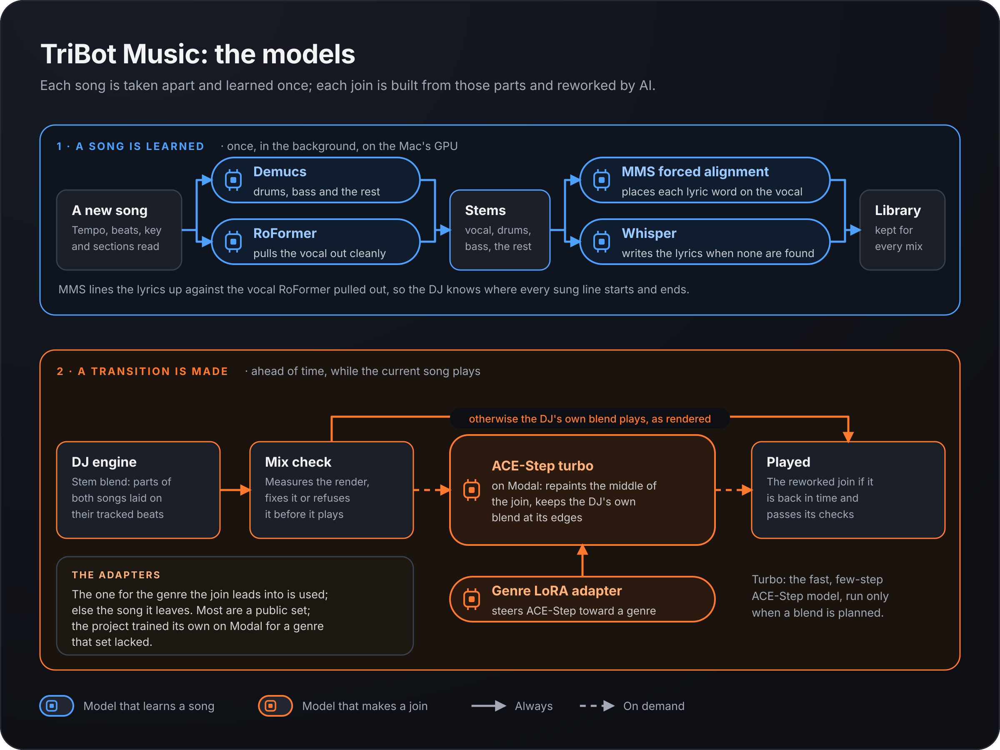

# Architecture

A high-level view of how TriBot Music is put together. Back to the [README](../README.md).

## The roles

| Role | What it does |
|---|---|
| Web player and panel | Playing, settings, and the mixing review. Sign-in is required. |
| Music bot | Owns the song library, the queue and the DJ engine. Each DJ session runs in its own worker process and renders every transition ahead of time. |
| Song library | Each song's analysis, lyric timing and a map of where the singing is. |
| Stems service | Separates songs into vocals, drums, bass and the rest, and places each lyric word on the vocal. Runs natively on the Mac's GPU. |
| Cloud GPU | Modal, used on demand for generated "AI mixes". |
| Public gateway | A separate, locked-down gateway that serves the limited demo panel. |

## Deployment: where each part runs

One always-on Apple Silicon Mac is the system's home. The music bot, the web panel and the public demo gateway run there in containers. The stems service runs natively beside them so that it can use the Mac's GPU directly. **Modal** is the external cloud GPU provider: it is called on demand to run **ACE-Step**, and it is also where the genre adapters were trained.

The public demo is the same player served as a limited panel: only the demo's features, no admin pages, a demo account behind a human check, and an allow-list of routes. It is reached through **Cloudflare**, a tunnel, so no port is opened on the Mac or the router. The full panel is reached only on a private network. Both are doors into the same music bot and the same DJ engine.

## How a song is learned

A song is learned once and reused. The work is done in the background, never in front of a live set.

Tempo is checked by more than one witness because beat trackers slip to related tempos (see [challenges](challenges.md)). Stems are separated in windows: what is about to be mixed first, the rest of the song later in small pieces.

## How a transition is planned

If the chosen move fails, the next one that fits is tried, down to an echo out, which works for any two songs. The next song, the move and the check are explained in [how it chooses](how-it-chooses.md).

## The models and what each one does

**Taking a song apart.** **Demucs**, a hybrid transformer separation model, splits a song into drums, bass and the rest. A **RoFormer** model first pulls the vocal out more cleanly than Demucs manages alone, and Demucs then splits what is left.

**Understanding the words.** **MMS forced alignment**, a speech model, takes a song's lyrics and the isolated vocal and places each word at the moment it is sung. **Whisper** transcribes the vocal when a song's lyrics cannot be found or do not fit.

**Reworking the join.** **ACE-Step** (turbo) is an audio generation model. It reworks the join of a blend, and **genre LoRA adapters** steer it toward the sound of the genre of the song the join leads into.

**Building it.** **Claude Code** plans, writes and tests the project as an orchestrator with worker agents, under the owner's direction.

### ACE-Step on Modal

The DJ builds its own stem blend of the join first, with the singers taken out. That blend, trimmed to a window around the swap, is sent to **ACE-Step** running on **Modal**, an external cloud GPU provider. ACE-Step repaints the middle of the window while the edges, which are the DJ's own blend, are held as they are. What comes back is lined up to the beat and checked for noise and timing, and only what it changed is added to the transition. The singers and the songs either side stay as rendered.

It runs on a cloud GPU on demand because generation is heavy and only needed for the occasional mix: the GPU is called when a mix wants it and idles otherwise. A live set never waits for it. If the result is not back in time, the planned stem blend simply plays.

### Genre adapters we trained

A **LoRA** adapter is a small add-on that nudges a large model toward a style without retraining it. For ACE-Step, the genre adapters steer the generated beat toward the sound of a genre. For a given transition the DJ uses the adapter for the genre of the song the join leads into, and falls back to the one for the song it leaves. Many of the adapters are ready-made public ones. For a genre the public set did not cover, the project trained its own on **Modal**, using songs of that genre. In the owner's listening comparison, takes with a tuned adapter sounded better than the plain model on every pair tried: closer to the genre's sound.

## Keeping heavy work away from a live set

- **Priority on the GPU.** Work for a running set goes first. Everything else, including learning a new song, runs in small pieces and steps aside when a set asks.
- **Nothing slow on the planning path.** Anything slow that a live set might want, such as an AI call, is cached or asked for in the background. A transition never waits for it.

## The public demo

The demo is a limited panel behind a separate gateway that lets through only an allow-list of routes, with no admin pages. Visitors pass a human check and are signed in to a demo account, and it connects to the same engine as the full panel. Demo songs are licence-cleared tracks, kept apart from everything else.
