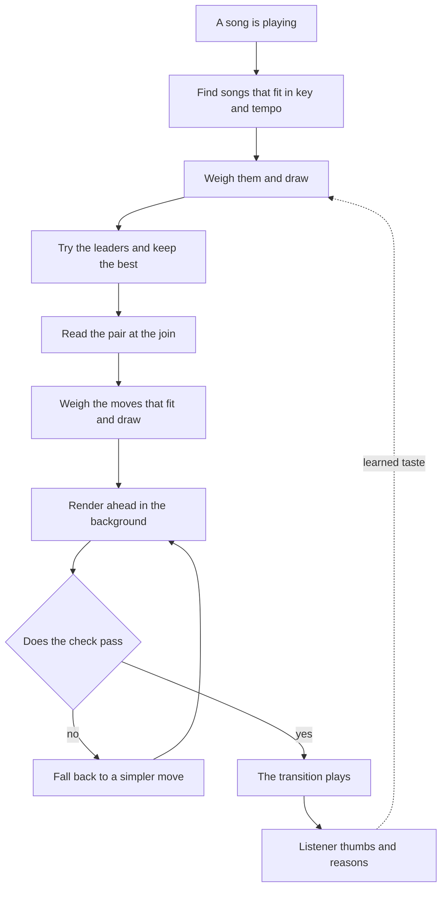

# How it chooses: the next song, the match, and the move

What the DJ considers, in what order and why. Back to the [README](../README.md). For what the moves sound like, see [how it mixes](how-it-mixes.md).

## 1. The question the DJ answers every few minutes

While a song plays, the DJ is already working on the next join. It asks four things in order:

1. What should play next?
2. How well do these two songs fit where they meet?
3. How do I get from one to the other?
4. Did it work?

Each answer narrows the next. The last one feeds back into the first two.

## 2. Choosing the next song

**Where candidates come from.** Listener requests first, in the order they came. With the DJ's reordering setting on, it may let a request wait a few songs if another fits better, but never leaves one behind for long. When there is no request, the DJ draws from its own library: every song it has already learned, so it knows the key, tempo, beats and singing of each before it is picked. It also keeps learning new songs, one at a time, only while no set is playing.

**What narrows them.** A song must be able to join the one playing:

- A key that mixes with the current one, by the Camelot wheel.
- A tempo within reach, counting half time and double time as the same pulse.
- A beat the DJ can follow steadily, because everything it lays down sits on the beat grid.
- Not a song already played in this set, and not another version or upload of one.
- Not a song of the wrong length for a set.

**What weighs them.** Among those that fit, each candidate carries a weight built from several considerations:

- **How near the key and tempo are.** Closer fits are favoured, but only softly.
- **Genre family.** Related families sit near each other; the DJ stays in a family for a while, then moves to a neighbour, rather than jumping across the library. If the listener asks for genres, or the night has settled into a theme, picks come from that kind of music first, its neighbours only when none is left.
- **Energy against where the night is.** See below.
- **How cleanly the singers can hand over.** A song that opens with its band before the voice can be joined with the outgoing singer finished. A song far from the current one in energy is less welcome, since a shouting singer after a whisper is a poor handover.
- **What is charting.** Songs that are charting are weighted in.
- **The listener's filters.** Genres, artists and remixes asked for in settings.
- **An artist just heard** counts against a song.
- **Learned taste.** Once votes show reliably what listeners like, the taste nudges the draw. Until then it is only shown.

**The night.** A set follows an arc: it warms up, builds, holds a peak, gives the room a breather, and goes round again. Each phase aims at a share of the library's own energy, so it suits whatever the library holds. The arc leans the draw. It forbids nothing.

**A draw, not a ranking.** The weights make some songs more likely, not certain. Two nights from the same library differ, and the near and the new still come round.

**Trying the leaders.** The DJ does not stop at the draw. It renders and judges a few leading candidates and keeps the one that joins best, with the learned taste added once it has earned a say. The ones it passed over are kept with the reason, and the panel shows them.

## 3. Matching the pair

At the join, the DJ reads both songs side by side:

- The two keys and the distance between them on the wheel, and whether a small pitch shift would bring them into line.
- The two tempos and how much one would have to stretch to meet the other.
- Where each song's phrases, sections and drops fall, and where the outgoing song can leave from.
- Where each singer's lines begin and end, and whether one is mid-line when the other would come in.
- Whether both songs have been separated into stems yet.
- The energy and loudness on each side of the join, and whether the next song lifts or drops.
- How long the next song's intro is, and whether a real drop is near.

This becomes a plain verdict the panel shows on each transition:

| Label | What kind of thing it means |
|---|---|
| Great match | The judge found nothing wrong. |
| Fair match | A good match with a few small flaws. |
| Hard match | At least one thing will sound off. It plays anyway, so a listener can hear it and vote. |

The labels come from the judge's verdict on the actual render, not from the key and tempo alone. A pair can look easy on paper and still earn a Fair, or look hard and come out clean.

## 4. Choosing the move

Each move states whether this pair fits it, and when it does not, says why. The reasons are shown in the panel, for example:

- The tempos are too far apart to lock the beats together.
- The beat drifts too much to lock.
- The songs are not split into parts yet.
- It is switched off in settings.
- It could not be done at this spot.
- The two singers would have sung over each other.

A few examples of fit. The redrum wants a real drop to land in. The stem blend wants both songs in stems, on a beat that locks, with an intro or a steady level to ride in on. The echo out fits any two songs and is the answer when the beats cannot lock. The pad routine wants a tempo-matched pair and a steady beat. A scratch is an entrance that any steady pair can take.

**From the moves that fit, the choice is weighted by:**

- How well the pair suits each move.
- The owner's switches, and the more, less or off setting for each move.
- Listener votes on the move.
- What was played recently, so the same move does not repeat and the showy moves rest between each other.
- Where the night is.

A clear winner is played outright. Otherwise it is a draw, and the rest of the draw order becomes the fallback list.

**Exit and entry points.** The DJ leaves the outgoing song on a phrase boundary, at the end of a line or a chorus, and lands the next song into a drop or on a first bar. For the stem blend it tries more than one exit, renders each, and keeps the cleanest. It will not hold a song for long to find a better one.

**Singers.** Line to line sits under every move. A final pass keeps two lead vocals apart and fixes any collision before the move is accepted.

**The fallback ladder.** If the chosen move cannot be rendered, or fails the check on its render, the next one that fits is tried. The ladder ends at an echo out, which works for any two songs, and then at a quick cut. A "play it safe" setting makes a flawed render give way to another move.

**Extras and sounds.** Risers, crashes and pumps are planned from the night's arc: more into a peak, none over a breather, resting after a run. Each has its own switch. The chords, bass and impacts are picked per transition from the pair's genre, key, tempo and energy, from the records first, never the same as the last time.

**Why it did it.** Each transition keeps its reasons: the move, the pair's match, the skipped moves and why, the exit chosen and the sounds. The panel shows them next to the thumbs.

## 5. Checking the result

A check measures the rendered join the way a mix engineer would listen to it: a hole where nothing plays, two basslines together, mud, a level jump at the switch, peaks. Where a fault can be corrected, it is, and a render is refused only when it cannot be. A separate judge then scores the render for named faults and gives the label above.

Then the listener has the last word. Thumbs and reason chips are held against the traits of each mix, and against the traits of the pair alone. When votes show reliably what listeners like, that taste feeds back into which songs are drawn (section 2) and which move is chosen (section 4). Until it has earned its place by predicting votes it was not fitted to, it is only displayed, never used.

## 6. What it will not tell you here

The considerations above are the whole outline. The weights, the thresholds, the way each move is scored and the exact order inside each draw are the part that took the listening, and they are not published. They changed whenever the owner's ear disagreed with a number.
